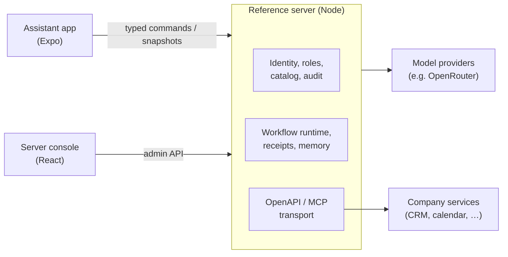

# Agent Client

A self-hosted AI assistant for teams: a chat and voice app for iOS, Android and the web, and a server that owns the models, credentials, permissions, memory and actions.

The app never talks to a model provider or a company tool directly. It renders typed cards (questions, approvals, results, progress) that the server produces. The server decides which model runs, which service actions a person may use and when a write needs explicit approval.

> **Status: development preview.** Everything described here works locally and is covered by tests, but it is not yet a production release or a security-audited service. See [current operating limits](docs/service-catalog.md#current-operating-limits).

## Features

**Assistant app** (`apps/mobile`, Expo / React Native)

- Chat and push-to-talk voice input with a live voice visualizer; optional spoken replies.
- Answers that show their numbers, records, schedules and comparisons as generated UI (OpenUI Lang: metrics, tables, charts, lists, forms) in the app's own design; explicit action approvals.
- Approvals are explicit, revision-bound and never implied by text or speech.
- Browser-based account sign-in with a device session stored in secure storage.
- A fresh chat after every launch and after long inactivity; history stays on the server.
- English and Czech.

**Server** (`apps/reference-server` and friends)

- Organizations, workspaces, roles and per-person access, backed by Better Auth.
- Services connected through OpenAPI or MCP; actions are discovered as disabled drafts and enabled deliberately.
- An organization-owned AI provider and model catalog, with per-workspace model routing for chat, decision, speech-to-text and voice replies.
- Durable command receipts: retrying a request never repeats a completed action.
- Audit log of configuration changes and tool runs (metadata only, no payloads or secrets).
- Encrypted credentials, strict origin checks and an explicit outbound allowlist.

**Server console** (`apps/server-admin`, React, TanStack Router/Query, shadcn/ui, Tailwind CSS v4)

- Overview of the assistant runtime, setup progress and recent activity.
- Services, plugins, model routing, usage limits, AI providers, people, workspaces, sign-in methods and audit log.
- A process designer with an AI conversation beside a visual canvas.
- MCP access for external agents: Connector (call the workspace's services directly) or Processor (submit tasks Niaro runs on the server).
- Light and dark themes, English and Czech, usable down to phone width.

## Architecture



| Area                                     | Location                                    |
| ---------------------------------------- | ------------------------------------------- |
| Server entry and configuration           | `apps/reference-server`                     |
| Identity, authorization, catalog, audit  | `apps/server-identity`                      |
| API/MCP transport and discovery          | `apps/server-integrations`                  |
| Native Mastra agent and checkpoint store | `apps/server-agent`                         |
| Workflow persistence and command runtime | `apps/fixture-server`                       |
| Server console                           | `apps/server-admin`                         |
| Assistant app and its cards              | `apps/mobile`, `packages/ui-catalog`        |
| Shared contracts and client transport    | `packages/protocol`, `packages/client-core` |

The workflow runtime keeps its historical `fixture-server` directory name; the reference server composes it.

## Quick start

Requires Node 22.13+ and pnpm (`corepack enable` installs the pinned version).

```sh
pnpm install --frozen-lockfile
npm run admin:build
mkdir -p .servers/local
cp examples/self-hosted/server.local.json .servers/local/server.json
npm run server -- .servers/local/server.json
```

1. Open `http://localhost:8793/admin/` and create the organization and its owner: on a new server the first account becomes the owner, and you land signed in with a first workspace.
2. Add an AI provider and the services you want the assistant to use.
3. Start the app in another terminal with `npm run android`, `npm run ios` or `npm run web` and sign in with the server address. The browser client runs on `http://localhost:8081`; add that origin to `allowedOrigins` in the profile and restart the server first.

The example profile makes no paid calls and has no real CRM or calendar connection. Keep everything under `.servers/` out of version control; `npm run server:admin-rotate-key -- .servers/local/server.json` prints a recovery key for emergencies. For HTTPS, reverse proxies and backups see [self-hosting](docs/self-hosting.md). To run the server as one container image with compose, Caddy HTTPS, backups and upgrades, see [deployment](docs/deployment.md).

For a phone on Wi-Fi, use `pnpm start --lan --port 8081` and open its QR code in the installed development build. The phone must reach the computer's LAN address on that port. `pnpm android --device` builds/installs a current Android client when native dependencies have changed; restarting Metro alone does not update native modules. See [mobile development troubleshooting](docs/self-hosting.md#mobile-development-over-wi-fi).

Expo scripts disable automatic dotenv loading: the root `.env` belongs to the server's SMTP configuration. Supply any additional public client variables explicitly to the frontend command.

## Development

New catalog commands use a native Mastra Agent with durable runs, conversation
memory, direct Niaro tools and per-step authorization processors. Niaro owns
identity, exact approvals, business receipts, long-term memory policy and the
guarded provider transport. Historical saved runs retain a temporary drain path.
Native [Tasks and goal return](docs/native-tasks.md) retain pending questions and
service approvals through detours, new chats and restarts. Opening is passive;
answers and approvals remain explicit. Transport profile 0.7 requires updating
the server and clients together.
See [Mastra integration](docs/mastra-integration.md) for ownership, storage and
remaining rollout checks; the original [prototype](spikes/mastra/README.md) stays
isolated.

No new start command or external Mastra service is required. The server opens
`<identity-db>.mastra.sqlite` beside its identity database, with file mode 0600.
Include both databases and SQLite journal files in a consistent stopped-server
backup. In-memory tests use isolated ephemeral stores. The mobile client and
console do not import Mastra. Existing provider/model and optional decision
verification settings remain in the console.

Custom service definitions now have an internal runner for typed native
action/agent workflows and standalone agents, with branching, exact approvals,
native conversation Memory, restart/resume and scoped
Loops. Native chat and Jev now share a [durable usage budget](docs/inference-budget.md),
with explicitly configured enforcement. Custom agent steps share their parent
budget, narrowed by frozen process limits, and can retrieve read-only saved
memory. Product Tasks identity, the public builder, activation and mobile
execution remain planned. See [service processes](docs/service-processes.md).

```sh
npm run check            # lint, boundaries, TypeScript, unit and identity tests
npm run test:agent       # native runtime, trust, approvals and crash regression
npm run test:processes   # registry, metadata HTTP, native workflows/agents and crash regression
npm run test:budget      # shared usage ledger, policy HTTP, native runtime and SIGKILL
npm run admin:build      # server console bundle
npm run build            # app export for web, iOS and Android
npm run storybook:web    # component catalog for the app's cards
pnpm eval:trust         # offline loop scenarios; exit 2 reports any recorded gap
```

For console work with hot reload, run `npx vite --config apps/server-admin/vite.config.ts` next to a running server and open `http://localhost:5174/admin/`.

Tests use synthetic data, local transports and isolated servers. Live provider, CRM and voice checks are explicit opt-in scripts and never part of CI. See [contributing](CONTRIBUTING.md) before opening a pull request.

## Documentation

- [Self-hosting, HTTPS and backups](docs/self-hosting.md)
- [Hosted MCP servers: definitions, runtimes and compose services](docs/hosted-servers.md)
- [Services, actions, models and limits](docs/service-catalog.md)
- [Custom service process definitions and version registry](docs/service-processes.md)
- [Generative UI in answers: output contract, component library and validation](docs/generative-ui.md)
- [Agent loop trust scenarios, results and known gaps](docs/agent-trust.md)
- [Server console and identity](docs/server-admin.md) · [Console design rules](apps/server-admin/DESIGN.md)
- [App sign-in](docs/app-sign-in.md) · [Service authentication](docs/service-authentication.md)
- [Use Niaro from an external MCP agent](docs/incoming-mcp.md) · [MCP authentication and OAuth](docs/mcp-auth-design.md)
- [Product goal and pilot readiness](docs/goal.md) · [UI system](docs/ui-system.md)
- [Protocol](docs/protocol.md) · [Decision records](docs/adr) · [Development history](docs/development-history.md)

## Contributing and security

Contributions are welcome; start with [CONTRIBUTING.md](CONTRIBUTING.md) and follow the [code of conduct](CODE_OF_CONDUCT.md). Report vulnerabilities privately as described in [SECURITY.md](SECURITY.md), never in a public issue.

## License

[MIT](LICENSE) © 2026 Filip Tůma
