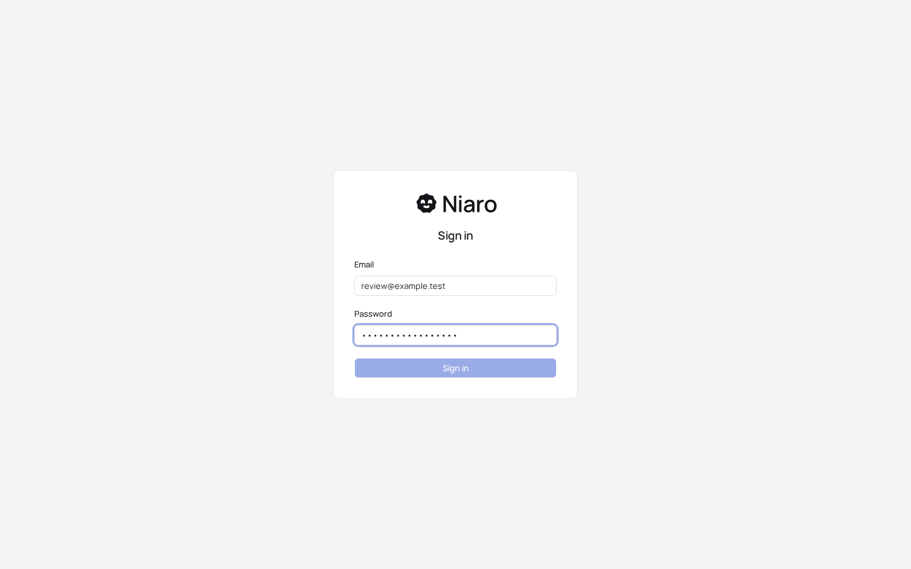
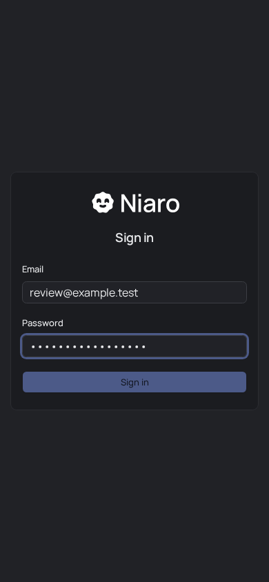
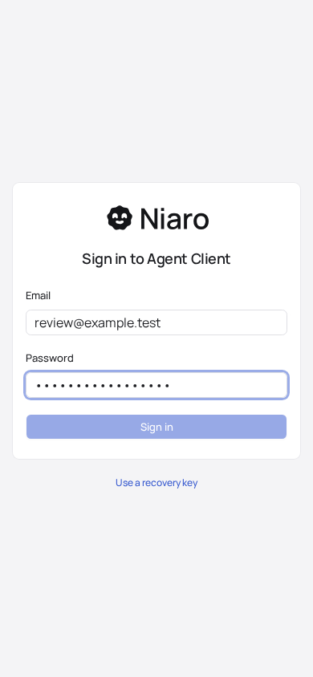

# Niaro logo delivery — independent final review R2

Verdict: **ready within the reviewed scope**. R1-01 is resolved, and no unresolved finding remains for the exact R2 subject. This is review acceptance, not publication or integration authorization.

## Exact subject

- Worktree: `/home/flamendrin/orca/workspaces/niaro/niaro-brand-assets`.
- Patch: `/tmp/niaro-orchestration-20261030/brand-assets-r2-worker-only.patch`.
- Patch SHA-256: `15d86faf06cc14436525f6685cc1769be27d56d17fd0daffd2a7392383adfdf0`.
- Manifest: `/tmp/niaro-orchestration-20261030/brand-assets-r2-worker-only-manifest.json`.
- Manifest SHA-256: `b955cf1f5f38e0f4ea71828585c9390a9c8e2075f559c573323baa20ad499b56`.
- Guarded dirty-baseline delta: 23 paths, comprising six existing and 17 new files; all 1,653 untouched paths still match the 1,659-path supplied seed. Baseline HEAD is `260b1eef413dc3e6295ef9776c2a5ea868a8ef0f`.
- Fresh independent reviewer: effective Orca launch `gpt-6-astra`, `xhigh`, dispatch `ctx_18fbcd2739e9`, task `task_085a7a861559`. No helpers. The reviewer made no production source or remote service changes.

The initial review is preserved at R1 review (not kept in the repository), with its exact original patch and evidence. R2 differs only in `apps/server-admin/web/app/app-root.tsx`: removing the unused `MessagesSquare` import and the ordinary sign-in icon override. All original 22 reviewed files remain byte-identical. The new file's before-hash is `cd41f9a2b46a8297b4ea6b3a129c7946fe2026d8c5afea2498109d500020078e`; its after-hash is `edd47328251959a01c06eac14fa408fc36f703b55dddff1a190d64cb12b291db`. The authentication behavior and meaningful status/error icons are untouched.

## Finding disposition

| ID | Severity | R2 disposition and evidence |
| --- | --- | --- |
| R1-01: end-user sign-in bypassed the Niaro logo | P2, required | **Resolved.** `app-root.tsx:272` now uses the default `AuthLayout` product mark. Independent rebuilt `/` displays the correct outlined Niaro lockup at desktop and phone widths in light/dark. Orca's actual DOM also contains image “Niaro”; see `orca-web-snapshot.json`, `browser-review.json`, and the four `web-*.png` captures. |

No additional finding was identified. The broad existing “Agent Client” account copy is outside the accepted logo/asset delivery scope and was not silently rebranded.

## Independent verification

| Check | Result and evidence |
| --- | --- |
| Exact patch and baseline | Pass. All 23 after-hashes and before-baseline hashes verified; original 22 unchanged; temporary patch application produces every expected byte. `subject-verification.json`. |
| Build and changed-source lint | Pass. Direct installed Vite binary rebuilt into this isolated `dist-admin/`; targeted ESLint passed. Only three expected bundle files emitted. Existing large-chunk warning remains. `build.log`, `lint.log`. |
| Actual web and admin identity | Pass. `/` and `/admin/`, each at 1440×900 and 390×844 under both light/dark. Title Niaro, meaningful heading/form, loaded 130.72×40 lockup, inlined favicon, no blank page or framework overlay. `browser-review.json`. |
| Colors and layout | Pass. All four light cases render the exact dark ink; all four dark cases render white. No horizontal overflow. Additional 360×800 admin captures confirm stored light/dark choices work against the opposite OS preference; `web-manual-*.png` are named by the harness but show `/admin/`. |
| Interaction | Pass. In all eight primary cases, synthetic email/password entry changes Sign in from disabled to enabled. No form submission or other non-GET request. |
| Console | No JavaScript exception or CSP error. Each case has only its expected signed-out fixture 401: `/admin/api/identity` for `/`, or `/admin/api/overview` for `/admin/`. Exact response URLs are recorded. |
| Remote state | Pass. Fresh MCP `list_assets`, `list_vards`, and both editable `get_vard` responses are identical to R1, including revisions, private state, all eight manual IDs/pins/recipes, and empty folder rules. `remote-unchanged.json`. |

Browser environment: actual newly built product code, Chromium `151.0.7922.34`, synthetic signed-out GET responses, exact source CSP, isolated reviewer-owned loopback server at `http://127.0.0.1:44987` during QA. Orca navigation/DOM worked. R1 Orca screenshot failure (“Screenshot timed out — the browser page did not draw a frame”) is preserved in `../r1/screenshot-probe.json`; the explicitly permitted existing Playwright fallback supplied screenshots. No browser or dependency was installed.

The unchanged R1 evidence remains applicable and was not needlessly repeated: exact approved geometry and outlined text; zero changed RGBA channels in 15 parity renders; readable 16/24 micro with three distinct transparent facial regions; real alpha in transparent outputs; opaque white-on-cobalt native icon; exactly three canonical repository SVGs plus the authorized service-only inverse; clean production naming; four private assets and two private Vards in the authorized Niaro workspace; all eight outputs restored byte-for-byte with existing CLI 0.8.3 in an empty isolated target; same manual IDs with intentional migration pins; authenticated current-source hashes and eleven anonymous 401 probes; no actual credential in changed files/bundle or runtime API-key use; actual navigation of both human Vard links; and four-mode Expo identifier/permission/plugin invariants plus introspection. The R1 report and evidence were not kept in the repository.

## Boundaries and completion

This review read root `spec-review/SKILL.md`, CONTRIBUTING, the web DESIGN rules and UI system, actual approved source and screenshot references, relevant source consumers, exact patches/manifests, and live read-only Vardum definitions. R1 was frozen before the coordinator-authorized author fix; R2 was independently checked after the author froze it again.

Native physical-device builds/launcher/splash appearance, other browser engines, real account submission, authenticated flows, and the unrelated full repository suite remain untested. Configuration introspection is not a native build. Historical deletion ordering is supported by supplied migration records and before/after snapshots, not independently witnessed; current complete inventory and no obsolete Vard references were verified. Privacy describes observed current access, not future policy. Remote resources were never mutated by the reviewer, and no publishing, emulator, main Metro, or unrelated service action occurred.

Reviewer-owned browser sessions and both local fixture servers were closed after QA. Review artifacts are retained under `/tmp/niaro-brand-delivery-review`; production files were not edited by this reviewer. Integrate only the guarded R2 package, never the superseded R1 patch, and re-review any material change to this subject.

## Screenshot evidence

End-user sign-in, light desktop:

End-user sign-in, dark phone:

Admin sign-in, light phone:

