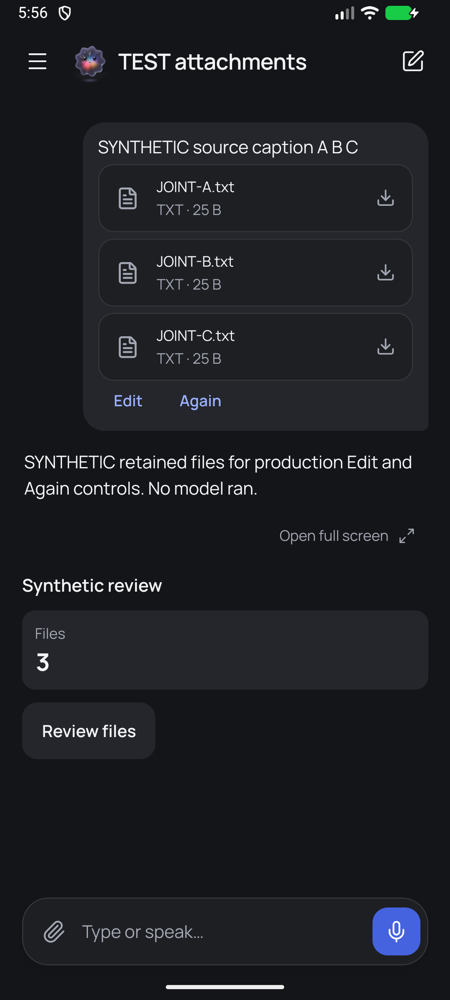

# Bounded joint MAIN acceptance · 2026-10-30

Accepted production subject is **joint-r7**, source manifest SHA `cf97542a1b21c84d0904e14270b9ad2d66edc73d1b5d9156e16e68f864f5a8c3`, own dirty-baseline patch SHA `55e4bc5c01c8623ecc01b7e3a6f1efbf206a930d008d08d3b21df0d8a9548a01`. All150 source rows/modes were independently verified. These final records are a separate documentation-only supplement; they change no production code or feature gate.

- [Broader source review](source-review.md): exact original accepted r4 review, SHA `15eaa87c9ae3cd81d14b9a65b746779fbff364b0619b3ffcd6475fd57643fff7`.
- [Reference/error correction review](correction-review.md): exact final r6 correction review, SHA `c4d2d6a5ce16dff5df612fe4949fc40696a8665e0b091f4dbf1664ae86bb692b`; JMR-01/JMR-02 closed.
- [Final native and r7 discovery source review](native-review.md): exact accepted report, SHA `6549e0e5b3d6e9b086b0a7a4b8e47351165ab23619c573a328c1f066d221626d`; JMR-03 closed, Android bounded matrix/restoration qualified.
- [Source evidence summary](source-evidence.json) and [native evidence/restoration summary](native-evidence.json) preserve identities, execution origins and limits. Counts from overlapping runs are not summed. Original reports refer to their full external packets; those raw logs/probes/state/APKs are intentionally not duplicated here.

Root accepted broader source in `msg_606d7e6afd9a`, final corrections in `msg_553bf2da43e0`, and final native/source/restoration in `msg_26db9649cc8e`. Required-check qualifications remain: historical UI probe lint error, exact12 inherited identity failures, and scoped broad-Jest/forced-exit evidence with separately tested brand correction. No whole-check green claim is made.

## Representative captures

R6 synthetic whole-App recovery result: source A/B/C, one explicit accepted Send, empty composer and no stale staging alert. The Files3 card is explicitly injected OpenUI fixture content, not an attachment-count header. R7 changes only passive discovery and retains these App bytes.

The final normal saved-account captures remain only in the original native packet. No normal account screenshot is copied here. Broad EN/CS,320dp/font2, keyboard, camera, voice, pet and OpenUI evidence is qualified by revision in the native report.

## Preservation and open gates

The normal MAIN runner and compatible updated APK are intentionally retained under root authorization; only8087+38683 reverse forwarding remains. All20 logical storage values, saved account/workspace/address/settings are verified unchanged. SecureStore ciphertext and SQLite bytes changed after the authorized normal refresh/reconnect; exact plaintext credential equivalence after that point is **not proved**, because no plaintext baseline was captured. Root accepted the normal App's current refresh state; it must not be rolled back. This qualification is integral to acceptance.

Live semantic memory quality/NIAR246 task3.4 and remaining NIAR246, converterB–E/OCR/CRM/image/model, resource coexistence/activation/task3.7, designated Hetzner, physical-device/iOS/HEIC and whole release journeys remain open. Processing stays unavailable/default-off and converterA unregistered. No publication/deployment/activation follows from these records.
